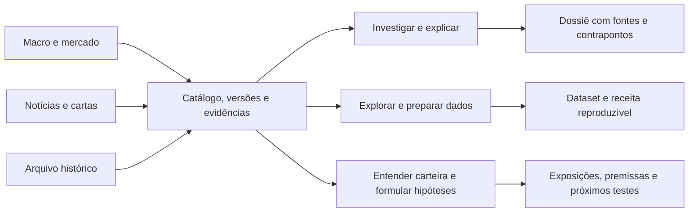

# Shape do OFL — workbench de pesquisa e dados financeiros

Decisão de produto: 2026-10-18. As personas foram aprovadas como base de trabalho;
as hipóteses de demanda e os resultados de uso continuam sujeitos a avaliação.

## Propósito e públicos

Transformar dados e documentos financeiros brasileiros em entendimento verificável,
pesquisa reproduzível e insumos confiáveis para outros trabalhos.

Finanças e dados são domínios primários. Analistas, assessores e consultores precisam
investigar e explicar; engenheiros, analistas e cientistas de dados precisam
explorar, transformar e reproduzir. Leigos precisam de linguagem progressiva e
perguntas guiadas para compreender mercados e suas carteiras. O portfólio de
engenharia é um objetivo secundário, distinto das carteiras de investimentos.

## Três jornadas sobre a mesma evidência

| Jornada | Entrada | Entrega |
| --- | --- | --- |
| Investigar mercados | Tema, pergunta, empresa ou hipótese | Evidências, contexto, contrapontos, limitações e um dossiê revisável |
| Explorar e preparar dados | Fenômeno, séries, período e uso pretendido | Dataset versionado, semântica, cobertura e receita reproduzível |
| Entender uma carteira | Pergunta, posições e objetivos fornecidos pelo usuário | Explicação de exposições e cenários compatível com os dados disponíveis |

O agente auxilia essas jornadas. Ele não define sozinho os limites do produto:
arquivos, API, MCP, notebooks e BI também são interfaces de primeira classe.
Operação, OCR e revisão são capacidades de suporte. Não se exige que todos os
usuários escolham primeiro uma especialidade técnica ou saibam códigos de mercado.

## Contratos compartilhados

Cada resultado precisa identificar pergunta/escopo, cobertura, fontes, versões,
datas relevantes, transformações e limitações. Data de observação, publicação,
coleta e versão de armazenamento são conceitos separados. Uma versão imutável de
um dataset não prova que ele reproduz o conhecimento disponível numa data passada.

Notícia, opinião de gestora, observação medida e número revisado por humano recebem
rótulos distintos. Trechos são dados não confiáveis, nunca instruções para o agente.
Conteúdo limitado a manchete/resumo mantém esse limite. Documentos sem data
permanecem sem data. Citações devem abrir a evidência usada, inclusive seu contexto.

Preservam-se as identidades financeiras e os decimais exatos de COTAHIST. Séries do
snapshot macro mantêm o tipo/precisão da origem; não recebem uma promessa fictícia
de exatidão decimal. Nenhum retorno ajustado, causalidade, adequação pessoal ou
backtest é apresentado sem os insumos e métodos que sustentem essa conclusão.

## Arquitetura e interfaces

Reutilizar lakehouse, snapshots, coletores, PostgreSQL/pgvector e armazenamento
privado. A camada de integração conecta esses ativos; não inicia outro crawler
nem exige trocar o banco. Arquivos originais e releases permanecem rastreáveis.

A aplicação privada oferece pesquisa e exploração com origem/escopo visíveis.
Acesso público continua restrito aos dados cuja publicação já é permitida. O agente
usa Inkwell e ferramentas autenticadas; cálculos e verificações são executados por
métodos testados. Síntese futura precisa de vínculo entre alegação e evidência.

## Primeira fatia de implementação

1. Conectar notícias e cartas já coletadas ao catálogo privado, com retomada,
   idempotência, datas, níveis de conteúdo, origem e processamento dos PDFs.
2. Registrar snapshots macro imutáveis e servir catálogo, consultas limitadas e
   exportações CSV presas à versão, sem consulta SQL arbitrária.
3. Expor essas capacidades em API, MCP e ferramentas Inkwell e numa entrada de
   workbench orientada a pesquisa e dados.
4. Validar com fontes sintéticas e uma amostra privada real antes de ampliar a
   indexação. A avaliação distingue conexão funcionando de qualidade de pesquisa.

Essa fatia entrega acesso útil aos ativos existentes. A síntese com contrapontos,
transformações avançadas, artefatos de pesquisa versionados e avaliação de carteira
com posições são próximas etapas explícitas; não serão declaradas prontas por
existirem botões ou ferramentas. A geração continua exigindo um endpoint de modelo
configurado; a consulta/exploração de dados não depende dele.

## Critério de avanço

Uma pessoa de finanças consegue localizar e inspecionar evidências relevantes;
uma pessoa de dados consegue selecionar e reproduzir uma série numa versão;
fontes sem data, conteúdo restrito e cobertura parcial continuam explícitos.
Em seguida aplicam-se as tarefas e gates de WORKFLOW.md/cases.json, medindo também
clareza para assessores/consultores/leigos e o valor adicional de usar um agente.

## Continuação sequencial implementada

Direção autorizada integralmente em 2026-10-18. A implementação agora inclui
revisões imutáveis por dono e achados de pesquisa; preparação multissérie com
transformações e ausências explícitas; carteiras avaliadas e cenários; Inkwell em
múltiplos passos com releitura de citações; listas por identidade, comparações de
preços/releases, verificações periódicas e diagnósticos com triagem versionada.

São estados de código e testes, não adoção ou implantação. O agente distingue
trechos conferidos de hipóteses interpretativas para revisão. A carteira usa
avaliações informadas pelo usuário. Não se comprova causalidade ou adequação
pessoal. Consulte IMPLEMENTATION.md e o backlog para os contratos e seus limites.
